# HTTPaaS: gestión de páginas y aplicaciones web

**Parcial 3 — Computación en la Nube**
**Integrantes:** Cristhian (Parte A) · Daniel Pérez (Parte B) · Wiliam (Parte C)
**Repositorio:** `github.com/lyc4nthrope/httpaas-paginas-web`
**Fecha:** noviembre de 2026

> **Estado de este documento (borrador).** La Parte B está desarrollada. Faltan las
> secciones de A y C y el banner B-12 (bloqueado por A7). Las capturas B-09 a B-11 se
> toman con el dashboard y se insertan en `docs/capturas/` o se enlazan desde el
> documento donde se lleven. Los huecos están marcados con **Pendiente (A)** o
> **Pendiente (C)**.

---

## 1. Introducción y objetivos

HTTPaaS es un servicio local que reproduce, en un PC, el flujo básico de un proveedor
de hosting: desde el navegador se crea una máquina virtual con Apache, se le asigna
un nombre DNS y se publica un sitio web comprimido en `.zip`. Todo el control vive en
el host; las máquinas virtuales solo ejecutan lo que la aplicación les indica.

**Objetivo general.** Construir una aplicación en Go que, sobre VirtualBox y Bind9,
permita crear, publicar y eliminar instancias Apache de forma reproducible, segura y
observable desde un dashboard.

**Objetivos específicos.**

1. Crear cada instancia a partir de un disco base multiconexión, sin copiar el disco
   completo, y configurarla sola en el primer arranque.
2. Registrar y quitar nombres `*.cloud.local` en un servidor DNS propio.
3. Publicar un `.zip` validado en dos capas: en el host y dentro de la VM.
4. Eliminar la instancia sin tocar el disco base y liberando su IP.
5. Mostrar el estado de cada instancia en un dashboard y permitir operarlo.

**Alcance.** Tres instancias simultáneas como máximo (configurable), red host-only
`192.168.10.0/24` y un adaptador NAT por VM para `apt`. No hay autenticación: la
aplicación escucha en `127.0.0.1` y solo la usa el host.

**Reparto.**

| Parte | Responsable | Qué entrega |
|---|---|---|
| A | Cristhian | Webapp Go, configuración, executor SSH, almacén, servicio con cola, rutas, adaptador `vbox` e integración |
| B | Daniel Pérez | VM `ns` y Bind9, `httpaas-dns`, resolución en el host, adaptador `internal/dns`, dashboard y documento final |
| C | Wiliam | VM `apache-plantilla`, `httpaas-firstboot`, `httpaas-publicar`, `instalar.sh`, disco multiconexión, adaptador `internal/publicar` y diagrama |

**Cómo leer este documento.** Las secciones 2 a 6 siguen la tabla de capturas del
plan general (§9): arquitectura y red, DNS, plantilla Apache, aplicación web y prueba
de punta a punta. La sección 7 resume los problemas; la 8, las mejoras; la 9, los
aprendizajes; la 10, el uso de IA; la 11, las referencias.

---

## 2. Arquitectura y red

**C-12 — Diagrama de la arquitectura.** El host ejecuta la webapp Go y VirtualBox; la
webapp habla con VirtualBox por `VBoxManage`, con `ns` por SSH y con cada instancia por
`scp`/SSH. Todas las VMs comparten la red host-only `192.168.10.0/24` y salen a
internet por un segundo adaptador NAT. **Pendiente (C):** reemplazar por el diagrama
definitivo y explicar cada flecha.

### 2.1 Componentes

- **Webapp Go** en `127.0.0.1:8080`: valida, encola trabajos y sirve el dashboard.
- **VirtualBox**: crea, arranca y elimina las VMs; el disco base es multiconexión.
- **VM `ns`** (`192.168.10.10`): Bind9 autoritativo de `cloud.local` y su zona inversa.
- **VM `apache-plantilla`** (`192.168.10.20`, solo durante la preparación): disco base
  `ApacheServer.vdi` con Apache, el servicio de primer arranque y `httpaas-publicar`.
- **Instancias** (`192.168.10.30`–`.99`): clones con disco diferencial sobre el base.

### 2.2 Plan de direcciones

| IP | Quién |
|---|---|
| `192.168.10.1` | Host, interfaz host-only |
| `192.168.10.10` | VM `ns` (Bind9) |
| `192.168.10.20` | VM `apache-plantilla` (solo preparación) |
| `192.168.10.30`–`.99` | Instancias Apache, asignadas por la webapp |

Todas las VMs tienen `nic1` host-only (sin DHCP) y `nic2` NAT. La comunicación del
proyecto va por host-only; el NAT solo se usa para `apt`.

### 2.3 Flujos

**Aceptar (crear).** La webapp valida el nombre, reserva la IP libre, guarda la
instancia en `creando` y encola el trabajo. La cola crea la VM, conecta el disco
multiconexión, escribe las *guest properties* y la arranca. Dentro, `httpaas-firstboot`
se configura sola y escribe `estado=listo`. La webapp espera, registra el nombre en
DNS, comprueba que resuelve y marca `lista`.

**Publicar.** La webapp valida el `.zip` en el host, lo copia a la instancia y ejecuta
`httpaas-publicar`, que vuelve a validar, descomprime en una carpeta temporal, cambia
el sitio de forma atómica y recarga Apache. Al final, la webapp comprueba la URL con
la cabecera `Host` correcta.

**Eliminar.** La webapp marca `eliminando`, quita el DNS, apaga la VM, la desregistra
con `--delete` (solo el disco diferencial) y libera la IP. Comprueba que
`ApacheServer.vdi` sigue existiendo. Si algo falla, la instancia queda en `error` con
el detalle y el botón Eliminar limpia lo que se haya creado.

### 2.4 Decisiones que sostienen el diseño

| # | Decisión | Por qué |
|---|---|---|
| D1 | La webapp corre en el host | Solo ahí existe `VBoxManage`; es el plano de control |
| D2 | Red host-only sin DHCP + NAT por VM | IPs fijas y predecibles; NAT solo para `apt` |
| D3 | Guest properties + `httpaas-firstboot` | Como el *user data* de EC2: la VM se configura sola |
| D4 | Cola de un trabajo a la vez | Evita carreras al asignar IPs y discos; crear tarda ~1 min |
| D5 | DNS dinámico con `update-policy local` y `nsupdate -l` | Sin llaves TSIG que repartir; basta SSH |
| D6 | Zonas en `/var/lib/bind`, nunca editadas a mano con `named` vivo | El journal `.jnl` se corrompe; AppArmor solo deja escribir ahí |
| D7 | Usuario `httpaas` con llaves y `sudo` solo para dos scripts | Mínimo privilegio |
| D8 | `BatchMode`, `accept-new` y `known_hosts` propio | Cada clon genera llaves nuevas; `-R` al eliminar |
| D9 | Argumentos separados, nunca `sh -c` | Evita inyección de comandos |
| D10 | Hostname RFC 1123 y reservados (`ns`, `www`, …) | Etiqueta DNS válida; mismo nombre para VM y host |
| D11 | Validar el zip en el host y en la VM | Dos capas contra zip slip, symlinks y bombas |
| D12 | Estado en `data/instancias.json` con escritura atómica | Sin base de datos; sobrevive reinicios |
| D13 | Puertos y adaptadores con Fakes | A, B y C trabajan en paralelo sin las VMs |
| D14 | Configuración de VMs con scripts versionados | Infraestructura como código, reproducible |
| D15 | `html/template` y un solo binario, sin framework | Menos piezas, menos errores |
| D16 | BIOS y SATA (AHCI) en plantilla y clones | El clon debe coincidir con el disco donde se instaló |

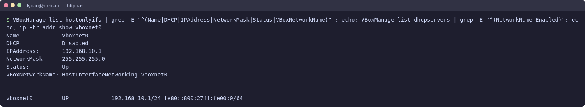

**P-01 — Red host-only del host.** Se ve el adaptador de VirtualBox con
`192.168.10.1/24` y sin DHCP. Importa porque es la puerta de entrada del host a las
VMs: si la red no existe con esa IP, nada del proyecto resuelve ni conecta.
**Pendiente:** confirmar la captura definitiva en el PC de cada integrante.

---

## 3. Servidor DNS Bind9 (Parte B)

El proyecto necesita que `paisajes.cloud.local` resuelva aunque el DNS del ISP no
sepa nada de ese dominio. Para eso `ns` es autoritativo de `cloud.local` y de su zona
inversa, y la webapp lo actualiza por SSH con un script fijo.

### B0. Prerrequisitos del host — ✅ 2026-11-07

- Adaptador host-only `192.168.10.1/24` con DHCP desactivado.
- Par de llaves `keys/httpaas_ed25519`; la pública se versiona en `deploy/llaves/`.
- Go, OpenSSH y VBoxManage.

**Problemas.** En Linux, VirtualBox 7 solo permite crear redes host-only dentro de
`192.168.56.0/21` hasta configurar `/etc/vbox/networks.conf`; Cristhian lo resolvió en
su PC (P1). En Linux y macOS, `mdns4_minimal [NOTFOUND=return]` en `nsswitch.conf`
manda todo `*.local` a mDNS antes que a DNS; se corrige en B5.

**Decisión.** Dos adaptadores por VM: host-only para las conexiones del proyecto y NAT
para `apt`. Uno solo no cumple las dos cosas.

### B1. VM `ns` — ✅ 2026-11-07

Debian 13 sin entorno gráfico, `enp0s3` host-only `192.168.10.10/24` sin gateway,
`enp0s8` por DHCP (NAT), usuario `httpaas` con las tres llaves de `deploy/llaves/`,
`sshd` con `PasswordAuthentication no` y `PermitRootLogin no`, e instantánea `ns-base`
con la VM apagada. Los pasos reproducibles están en `deploy/ns/README.md`.

**Recursos.** La VM quedó con EFI, 2 vCPU, 1024 MB y disco de 18 GB. El plan preveía
BIOS, 1 CPU, 512 MB y 8 GB: se mantuvo EFI porque el disco ya estaba instalado así y
cambiarlo obliga a reinstalar el cargador; los recursos se ajustaron al instalar y
quedaron documentados en el README. La restricción de BIOS y SATA del proyecto es del
disco multiconexión de la plantilla, no de `ns`.

**Problemas.**

| Síntoma | Causa | Solución |
|---|---|---|
| `ns` no arranca: *no bootable option or device* | NVRAM vacío al crear la VM copiando el VDI | `grub-install --removable` |
| `grub-install: command not found` | Solo estaba el GRUB que arranca | `apt install grub-efi-amd64` |
| `apt` falla con *Temporary failure resolving* | `enp0s8` en `DOWN` y `resolv.conf` con DNS heredados | Interfaces correctas y `prepend` de DNS en `dhclient.conf` |

**Decisiones.**

- `ns` **no** la aprovisiona la webapp: es plataforma previa (D14). Automatizarlo es
  trabajo futuro (M2).
- El endurecimiento de `sshd` va **después** de probar la llave: al revés, un error en
  `authorized_keys` deja la VM solo accesible por consola.
- La instantánea se toma con la VM apagada: una instantánea con RAM guardada es más
  frágil como imagen base.
- La VM se resuelve a sí misma: `named` primero y el DNS del NAT después.

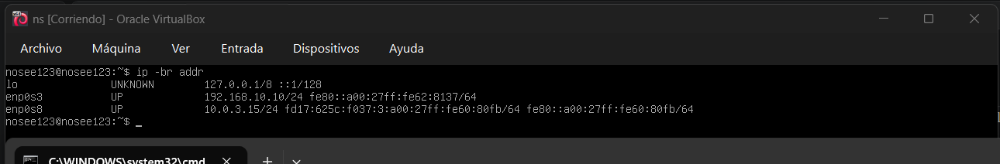

**B-01 — Interfaces de `ns`.** `ip -br addr` muestra `enp0s3` con
`192.168.10.10/24` (host-only) y `enp0s8` con una IP del NAT. Importa porque confirma
la IP fija que usará la webapp y la salida a internet para `apt`.

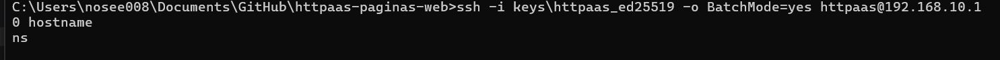

**B-02 — SSH desde el host sin contraseña.** `ssh -i keys/httpaas_ed25519
httpaas@192.168.10.10 hostname` devuelve `ns`. Importa porque es el mismo canal que
usará el adaptador `internal/dns` para ejecutar `httpaas-dns`.

### B2. Zona `cloud.local` estática — ✅ 2026-11-08

Cuatro archivos versionados en `deploy/ns/` y copiados a la VM:

| Archivo | Destino | Qué hace |
|---|---|---|
| `named.conf.options` | `/etc/bind/named.conf.options` | Escucha en `127.0.0.1` y `.10`; atiende la red del proyecto; recursión con reenvío |
| `named.conf.local` | `/etc/bind/named.conf.local` | Declara las dos zonas como `type primary` con `update-policy local` |
| `db.cloud.local` | `/var/lib/bind/db.cloud.local` | Zona directa: `ns A 192.168.10.10` |
| `db.192.168.10` | `/var/lib/bind/db.192.168.10` | Zona inversa: `10 PTR ns.cloud.local.` |

Se valida con `named-checkconf` y `named-checkzone` **antes** de reiniciar; los
archivos de zona quedan `bind:bind` en `/var/lib/bind`.

**Problemas.**

| Síntoma | Causa | Solución |
|---|---|---|
| `named-checkconf`: `unknown option 'update-privacy'` | Transcripción manual de `update-policy` | Corregir y volver a validar |
| `dig ns.cloud.local` devuelve `.0` | El `A` se escribió con la dirección de red | Corregir a `.10` y subir el serial |
| `rndc reload cloud.local` falla con *dynamic zone* | BIND no recarga desde archivo una zona dinámica | `systemctl restart named` (no había journal) |

**Decisiones.**

- Los archivos de zona van en `/var/lib/bind`: `bind` necesita escribir el journal y
  `/etc/bind` es de `root` (D6).
- `update-policy local` en vez de una llave TSIG repartida a mano.
- `forwarders` + `recursion`: las instancias resuelven `deb.debian.org` a través de `ns`.
- Serial `YYYYMMDDnn`; cada zona tiene el suyo y `nsupdate` lo incrementa solo.
- `/var/lib/bind` es `root:bind` con `drwxrwxr-x`; los `db.*` son `bind:bind`.

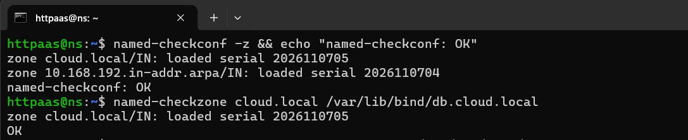

**B-03 — Validación de la configuración.** `named-checkconf` y `named-checkzone` no
imprimen errores y muestran el serial cargado. Importa porque valida antes de
reiniciar: un error de sintaxis dejaría `named` caído y sin DNS al proyecto.

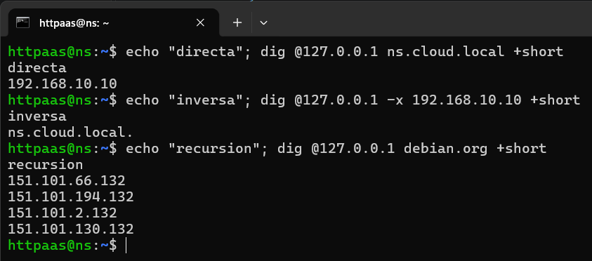

**B-04 — Zona directa, inversa y recursión.** Los tres `dig` muestran `ns → .10`, el
PTR inverso y una respuesta de `debian.org` por recursión. Importa porque cubre las
tres cosas distintas que debe hacer `ns`: resolver el proyecto, la inversa y salir a
internet.

### B3. Actualización dinámica con `httpaas-dns` — ✅ 2026-11-09

`ns` deja de editarse a mano. `deploy/ns/httpaas-dns` recibe `agregar`, `quitar` y
`listar`; valida el host (`^[a-z][a-z0-9-]{1,30}[a-z0-9]$`) y la IP
(`192.168.10.1–254`) antes de ejecutar nada, y rechaza `ns` y las IPs reservadas
`.1`, `.10` y `.20`. `agregar` hace dos bloques de `nsupdate -l` (uno por zona, cada
uno con su `send`) y confirma con `dig`; `quitar` borra `A` y `PTR` y no falla si no
existía; `listar` hace un `AXFR` filtrado. El `sudoers` permite **solo** ese script y
se valida con `visudo -cf`.

**Problemas.**

| Síntoma | Causa | Solución |
|---|---|---|
| `listar` devuelve `prueba.cloud.local.` | El `sed` anclaba `$` al final de una línea que termina en la IP | Separar con `awk` y quitar el sufijo ahí |
| `agregar ns` dice *invalid host* en vez de *reserved* | El regex de longitud (mínimo 3) rechazaba `ns` antes del chequeo de reservado | Mover el chequeo de `ns` antes del regex |
| `apt` y `dig` sin `@servidor` fallan | El DHCP entregó un DNS inalcanzable | `prepend` en `dhclient.conf` (B1) |

**Decisiones.**

- `nsupdate -l` usa la llave de sesión de `named`; no hay secreto que distribuir.
- Dos bloques con dos `send`: un mensaje DNS UPDATE pertenece a una sola zona;
  mezclar `A` y `PTR` falla con `NOTZONE`.
- `update delete` antes de `update add`: reagregar un host no falla.
- Confirmar con `dig` dentro del script: el código de salida significa "el registro
  está", no "nsupdate no se quejó".
- Rechazar `ns`: sobrescribirlo tumbaría la plataforma.
- Rechazar `.1`, `.10` y `.20`: escribir `.10` borraría el `PTR` `10 PTR
  ns.cloud.local.` y la confirmación con `dig` seguiría pasando porque el `A` queda:
  sería una falla silenciosa.
- `instalar.sh` no sobrescribe zonas existentes; `--forzar-zonas` es la excepción.

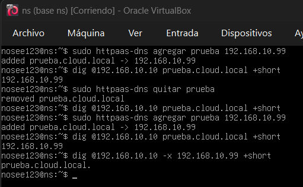

**B-05 — Alta de un registro dinámico.** `httpaas-dns agregar prueba
192.168.10.99` responde con el alta y `dig` devuelve `.99`. Importa porque es
exactamente la operación que la webapp hará por SSH al crear una instancia.

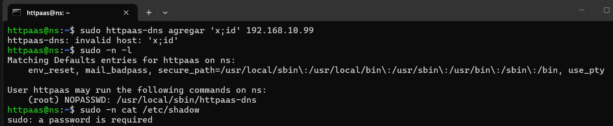

**B-06 — Rechazo de un nombre malicioso y de `sudo cat`.** El script rechaza
`x;id` y `sudo -n cat /etc/shadow` pide contraseña. Importa porque demuestra que los
datos no se interpolan y que `httpaas` solo puede ejecutar `httpaas-dns`.

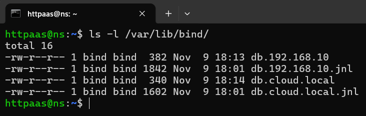

**B-07 — Journal de la zona.** Los `.jnl` en `/var/lib/bind` prueban que la
actualización fue dinámica (RFC 2136), no una reescritura del archivo. Importa porque
es la diferencia entre el camino soportado y el que corrompe la zona.

### B4. Imagen `ns.ova` — ✅ verificada 2026-11-09

`VBoxManage export ns -o ns.ova` con la VM apagada, validado con `import --dry-run`
antes de compartirlo: 1.14 GB, disco de 18 GB `streamOptimized`, `Debian13_64`,
2 vCPU, 1024 MB, host-only + NAT. El `.ova` está en `.gitignore` y se movió fuera del
repositorio.

**Verificación externa.** Cristhian importó el `.ova` en su PC con
`scripts/importar-ns.sh` (PR #4) y `scripts/verificar-ns.sh` pasó los chequeos de
B1–B3: Bind9 responde, las zonas están bien y `httpaas-dns` registra y quita. B4
queda cerrada.

**Decisiones.** `.ova` y no `.ovf` (un solo archivo); fuera del repositorio (1.14 GB y
`git clean` lo borraría); `--dry-run` antes de compartir; `--vmname ns` al importar;
el OVA no lleva la instantánea `ns-base`.

### B5. Resolución de `*.cloud.local` en el host — ✅ 2026-11-09

`ns` ya respondía, pero el sistema operativo del host no le preguntaba. Se conecta sin
romper internet con DNS dividido:

- **Windows:** regla NRPT para `.cloud.local` → `192.168.10.10`.
- **Linux:** `scripts/dns-host-linux.sh` (idempotente, con `--undo`) reubica `dns`
  antes de `mdns[46]_minimal` conservando los demás módulos; con `systemd-resolved`
  usa `resolvectl dns/domain`; sin él, pone `nameserver 192.168.10.10` como primera
  línea de `resolv.conf`.
- Los dos procedimientos y cómo deshacerlos están en `docs/parte-b/dns-host.md`.

**Problemas.**

| Síntoma | Causa | Solución |
|---|---|---|
| `ping 192.168.10.10` da 100 % perdidos justo tras `startvm` | La VM aún está en el arranque EFI | Esperar a que `named` esté activo |
| `Resolve-DnsName 192.168.10.10` no devuelve el PTR | NRPT cubre `.cloud.local`, no la zona inversa | No afecta al navegador; consultar con `-Server` |
| `nslookup ns.cloud.local` falla con la regla puesta | `nslookup` no usa NRPT | Probar con `Resolve-DnsName` o `ping` |
| `Resolve-DnsName ns.cloud.local -Server 8.8.8.8` devuelve el registro | NRPT se aplica antes que `-Server` si el nombre cae en el sufijo | Usar `nslookup` para consultar otro servidor |

**Decisiones.**

- NRPT y no `hosts`: resuelve todo el sufijo y cubre instancias nuevas.
- DNS dividido: solo `cloud.local` va a `ns`; el resto sigue por el ISP.
- El script preserva módulos y solo reubica `dns`; no impone una línea.
- `getent hosts` como verificación final: usa el mismo camino NSS que el navegador;
  `dig` habla DNS directo y se salta `nsswitch.conf`.

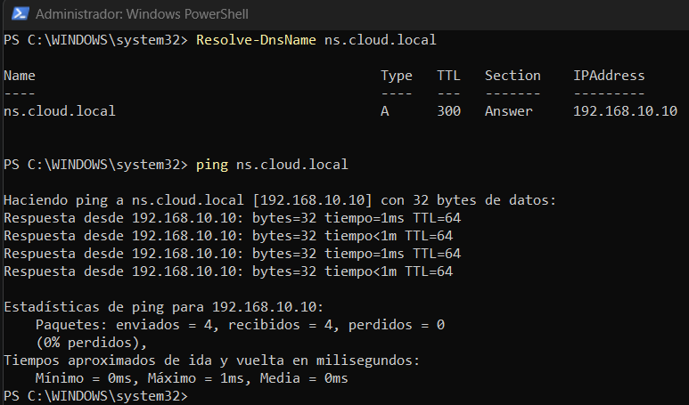

**B-08 — El host resuelve `cloud.local`.** `Resolve-DnsName ns.cloud.local` devuelve
`192.168.10.10`, `ping` responde 4/4 y `debian.org` sigue funcionando. Importa porque
es la prueba de que el navegador puede abrir `http://paisajes.cloud.local` sin romper
el internet del host.

### B6. Adaptador `internal/dns` — ✅ 2026-11-09

La webapp deja de hablar DNS a mano y usa `puertos.DNS`. `internal/dns/dns.go`:

1. `Nuevo(executor, cfg)`: no conecta; el SSH y el DNS solo se tocan al llamar.
2. `Agregar`/`Quitar`: validan antes de construir el comando y ejecutan
   `sudo /usr/local/sbin/httpaas-dns  <args>` con `executor.Command`, nunca con
   `sh -c`.
3. `Resolver`: `net.Resolver` con `PreferGo` y `Dial` fijo a `192.168.10.10:53`; no
   depende de NRPT ni de `nsswitch.conf`.
4. `ejecutar`: revisa `ExitCode`, porque el executor solo devuelve `error` cuando el
   comando no se pudo entregar.

**Problemas.**

| Síntoma | Causa | Solución |
|---|---|---|
| `make vm-test` se salta la prueba | No existe `config.json` (gitignored) | Config temporal con `HTTPAAS_CONFIG` |
| El adaptador podía reportar éxito con un comando fallido | `executor.SSH.Run` solo devuelve `error` para fallos de transporte | Revisar `res.ExitCode` y devolver el `stderr` |

**Decisiones.**

- `Resolver` recibe el label, no el FQDN: `instancias` llama `Resolver(ctx, nombre)` y
  el adaptador agrega el dominio; así nadie construye `x.cloud.local.cloud.local`.
- `Resolver` no aplica `ValidarHostname`: B6.5 necesita resolver `ns`, que está
  reservado. El nombre solo llega a `net.Resolver`, nunca a una línea de comandos.
- El `Dial` se fija en `Nuevo`: un solo lugar decide a quién se pregunta.
- Un `exit != 0` es error con el `stderr`: el mensaje útil lo escribe el script.
- `lookup` es un campo para probar sin red; el camino real lo cubre la prueba `vm`.

### B6.5. Validación de `ns` al arrancar — ✅ código y prueba VM; banner pendiente

`Comprobar(ctx) error` resuelve `ns` con el mismo `Resolver` y compara con
`cfg.DNS.IP`. Si falla o resuelve a otra IP, devuelve `*errorComprobacion`: el mensaje
es la receta para el usuario (`VBoxManage import ns.ova` o
`deploy/ns/instalar.sh`) y la causa técnica queda en `Unwrap`. No crea ni repara nada.
No se agregó a `puertos.DNS`: es un diagnóstico del adaptador y el contrato §4.2 no
cambia.

**Verificación.** Cuatro pruebas unitarias (`OK`, servidor caído, IP equivocada, host
vacío) y `TestVMComprobar` contra `ns`. El camino de error se comprobó apuntando
`dns.ip` a `192.168.10.250`: tarda 5.01 s y devuelve la receta exacta.

**Pendiente.** El banner en el dashboard (B-12) necesita `web.Vista.DNSAviso` y el
cableado de A7; el modo real todavía no arranca. Se agregará el bloque
`{{with .DNSAviso}}` en cuanto exista el campo.

---

## 4. Plantilla Apache y disco multiconexión (Parte C)

> **Pendiente (C).** Esta sección la completa Wiliam con el resultado real de C1–C8,
> sus problemas y sus decisiones. La revisión del PR #2 dejó identificados varios
> bloqueos que deben estar corregidos antes de cerrar esta sección: sintaxis de
> `httpaas-firstboot`, uso de `BASH_REMATCH` para la IP, `instalar.sh` (llaves,
> `PasswordAuthentication`, rutas de `scripts/`), chequeo de symlinks en el validador
> Go, detección de symlinks con `pipefail` y `gofmt`.

### C1. VM `apache-plantilla` base

Debian 13 sin entorno gráfico, BIOS, SATA (AHCI), disco dinámico de 6 GB
`ApacheServer.vdi`, `enp0s3` host-only `.20` sin gateway y `enp0s8` DHCP. Apache,
`unzip`, `sudo`, `curl` y el usuario `httpaas` con las tres llaves.

### C2. Guest Additions

Instalar las Guest Additions para que `VBoxControl` funcione; reiniciar y quitar el
disco de las Additions.

### C3. Servicio de primer arranque `httpaas-firstboot`

Lee `/httpaas/hostname`, `/httpaas/ip`, `/httpaas/dominio` y `/httpaas/dns`, valida,
cambia hostname y red, genera identidad nueva, configura Apache y la página
provisional, y escribe `/httpaas/estado = listo` (o `error:linea-N`). Es idempotente
con `/etc/httpaas/aplicado`.

### C4. Script de publicación `httpaas-publicar`

Valida el argumento, lee el nombre de `/etc/httpaas/aplicado`, rechaza rutas
peligrosas y symlinks, limita a 2000 archivos y 200 MB, descomprime en una carpeta
temporal, exige `index.html` en la raíz o dentro de una única carpeta, cambia el sitio
de forma atómica y recarga Apache con rollback si `configtest` falla.

### C5. `instalar.sh` y disco multiconexión

Congela la plantilla: paquetes, usuario, llaves, `sshd`, scripts, unidad systemd y
`sudoers`. Desconecta el disco, lo mueve, lo respalda y lo deja `multiattach`.

### C6. Clonación manual y especificación para A

Procedimiento reproducible para crear un clon con disco diferencial y guest
properties; es lo que usa el adaptador `vbox` de A.

### C7. Adaptador Go `internal/publicar`

Implementa `puertos.Publicador` con `executor.Executor`, valida el zip en el host y
mapea los códigos 2/3 del script a errores de validación.

### C8. Diagrama y material de demostración

Diagrama de arquitectura y guion de la demo. **Pendiente (C):** insertar C-12 en la
sección 2 y las capturas C-01 a C-11 en esta sección.

**C-01 — Configuración de `apache-plantilla`.** `showvminfo` con firmware, controlador
y NIC. Importa porque el clon debe coincidir con el disco donde se instaló.
**Pendiente (C):** completar el pie.

| Captura | Qué debe mostrar |
|---|---|
| C-02 | Página por defecto de Apache desde el navegador del host |
| C-03 | Lectura y escritura de guest properties en ambas direcciones |
| C-04 | `systemctl status httpaas-firstboot` |
| C-05 | Estado `listo` visto desde el host |
| C-06 | Página provisional con el `Host` correcto |
| C-07 | Publicación correcta |
| C-08 | Rechazo de `zipslip.zip` |
| C-09 | `showmediuminfo` con `Type: multiattach` |
| C-10 | Las dos VMs corriendo con sus discos diferenciales |
| C-11 | Después de eliminar, el disco base intacto |

> **Pendiente (C):** completar el pie de cada una con qué se ve y por qué importa.

---

## 5. Aplicación web de gestión (Partes A y B)

> **Pendiente (A).** Esta sección la completa Cristhian con A1–A7: contrato, config,
> executor, almacén, servicio con cola, rutas y adaptador `vbox`. Para cada fase:
> qué se hizo, problemas y decisiones, y las capturas A-01 a A-10.

### A1. Contrato común

`internal/puertos` define `Hipervisor`, `DNS` y `Publicador`, con Fakes para trabajar
sin VMs. Es el acuerdo que permite a A, B y C avanzar en paralelo.

### A2. Configuración, executor SSH y registro

`config.Config` valida `config.json`; `internal/executor` ejecuta comandos con
argumentos separados y `internal/oplog` registra lo que pasa.

### A3. Almacén y asignación de IPs

`internal/almacen` guarda `data/instancias.json` de forma atómica, reserva la primera
IP libre y detecta instancias `perdida`.

### A4. Servicio orquestador con cola

`internal/instancias` valida, reserva, encola y ejecuta los flujos crear/publicar/
eliminar de a uno. Los estados son `creando`, `lista`, `publicando`, `eliminando`,
`error` y `perdida`.

### A5. Servidor web y rutas

`internal/web` sirve `GET /`, `POST /instancias`, `POST /contenido`,
`POST /instancias/{nombre}/eliminar`, `GET /api/instancias` y `GET /salud`, con
POST→303→GET, flash, 422 por campo y CSRF por `Origin`.

### A6. Adaptador VirtualBox

`internal/vbox` crea la VM, conecta el disco multiconexión, escribe las guest
properties, arranca, espera `listo` y elimina sin tocar el disco base.

### A7. Integración en `dev`

Conecta los adaptadores reales en `main.go` y habilita el modo real. Es la fase que
desbloquea B6.5/B-12 y la prueba completa.

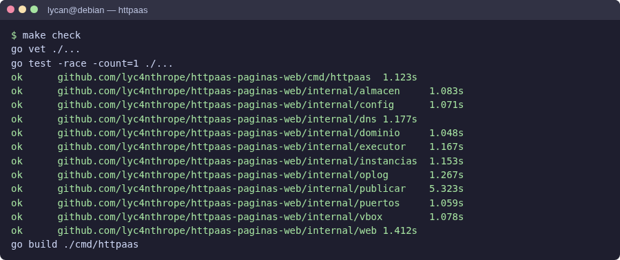

**A-01 — `make check` en verde.** Compila, pasa `gofmt`, `go vet` y las pruebas.
Importa porque es la puerta de calidad antes de cada commit. **Pendiente (A):**
completar el pie y las capturas A-02 a A-10.

| Captura | Qué debe mostrar |
|---|---|
| A-02 | Workflow de GitHub en verde |
| A-03 | Línea del registro de un comando real |
| A-04 | Dashboard simulado con una instancia en `creando` |
| A-05 | Error 422 mostrado en el formulario |
| A-06 | `VBoxManage list vms` con la instancia creada |
| A-07 | `showhdinfo` del disco base con su hijo diferencial |
| A-08 | Después de eliminar: la VM no está y el `.vdi` base sí |
| A-09 | Formulario con `paisajes` y `paisajes.zip` |
| A-10 | Dashboard con la instancia `lista` y su enlace |

> **Pendiente (A):** completar el pie de cada una con qué se ve y por qué importa.

### B7. Dashboard — ✅ 2026-11-09

La pantalla que ve el usuario. Part B reescribe la plantilla provisional de A5 en
`internal/web/templates/dashboard.html`.

**Lo que se hizo.**

1. **Estados con color y texto:** `` con un
   punto y la etiqueta; verde `lista`, ámbar en proceso, rojo `error`/`perdida`.
2. **Responsive a 360 px:** bajo 640 px la tabla pasa a tarjetas con
   `data-etiqueta` y `::before`.
3. **Accesibilidad:** `:focus-visible`, `role="status"` en el aviso, `role="alert"` en
   los errores, etiquetas con `for`, botones con texto.
4. **Contrato de B7:** un formulario `multipart/form-data` con Aceptar/Publicar,
   enlace en pestaña nueva, IP/24, VM, fecha, Eliminar con diálogo y estado vacío.
5. **Rediseño:** descripción de la página, tira de tres pasos, tarjetas, píldoras,
   contador y selector de archivo propio (label + nombre) para que el texto nativo no
   ensanche la página. Estilos inline.
6. **Diálogo de eliminación:** `<dialog>` nativo con Cancelar/Eliminar y `confirm()`
   de respaldo.
7. **Publicar inteligente (mejora progresiva):** con JavaScript, Publicar crea la
   instancia si no existe, espera `lista` sondeando `/api/instancias` y luego sube el
   zip. Sin JavaScript quedan los dos botones del plan. La pestaña debe quedar abierta
   (~1 min en real); la versión robusta es M3.

**Verificación.** `go test ./internal/web/` en verde; dos instancias `.30`/`.31` con
sus píldoras y enlaces; 360 px reales con el protocolo de DevTools; y el flujo
`creando → publicando → lista` publicando sin crear antes. Un nombre inválido muestra
el aviso y no crea nada.

**Problemas.**

| Síntoma | Causa | Solución |
|---|---|---|
| El formulario no se alineaba con la tabla | `max-width: 720px` en el panel | Panel a ancho completo con dos columnas en escritorio |
| En móvil se cortaba hasta el título | El `input[type=file]` nativo imponía su ancho intrínseco | Selector propio, `min-width: 0` y `minmax(0, 1fr)` |
| La captura a 360 px salía recortada | El headless de Edge clampa la ventana a ~500 px | Viewport real con `Emulation.setDeviceMetricsOverride` |
| El error de publicar aparecía bajo el nombre | `cambiarEstado` usa `CampoNombre` para todos los errores de estado | Es de A; la vista lo muestra donde llega |

**Decisiones.**

- Estilos inline, no `static/estilos.css`: `web.go` solo embebe `templates/*.html`.
- `<meta refresh>` en vez de polling: el plan lo dejaba como opcional.
- Publicar inteligente como mejora progresiva: no cambia rutas ni la figura.
- Diálogo `<dialog>` en vez de `confirm()`: mejor UX, con respaldo.

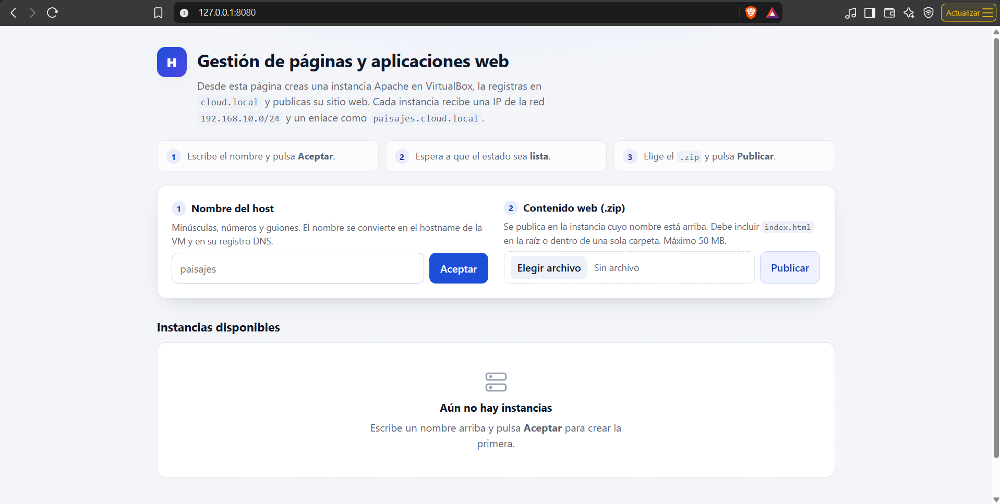

**B-09 — Dashboard vacío.** Se ve el formulario con sus dos pasos, la descripción de
la página y el estado vacío. Importa porque es la primera impresión del usuario y
muestra que la pantalla explica qué hace.

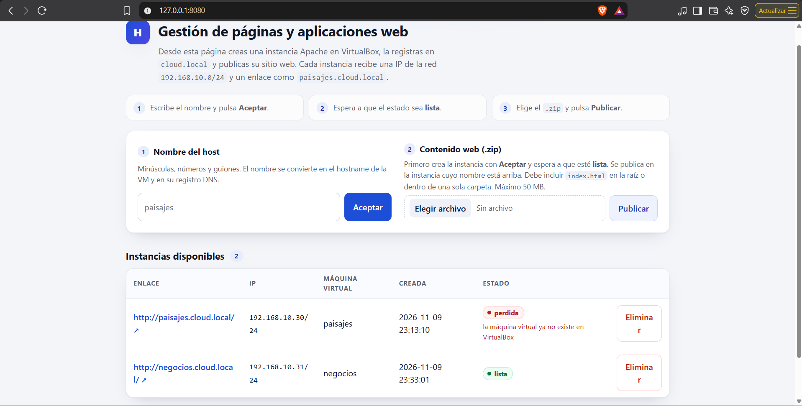

**B-10 — Dos instancias, como en la figura.** `paisajes` en `.30` y `negocios` en
`.31`, con enlace, IP/24, VM, fecha, estado `lista` y Eliminar. Importa porque es el
estado normal de la aplicación y coincide con la figura del enunciado.

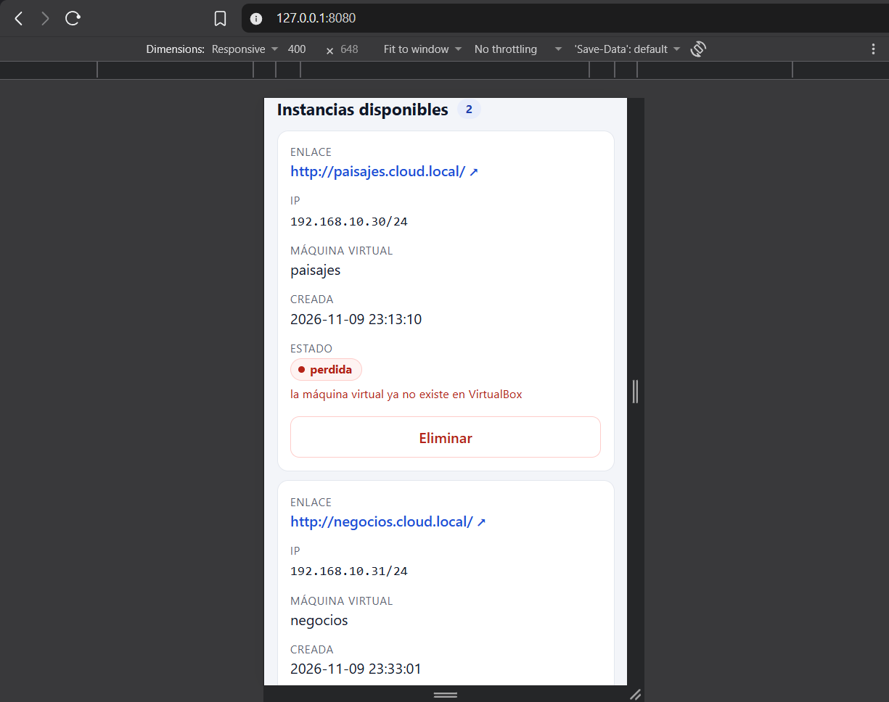

**B-11 — El dashboard a 360 px.** La tabla pasa a tarjetas y el formulario se apila.
Importa porque demuestra que la pantalla es usable en un celular, no solo en
escritorio.

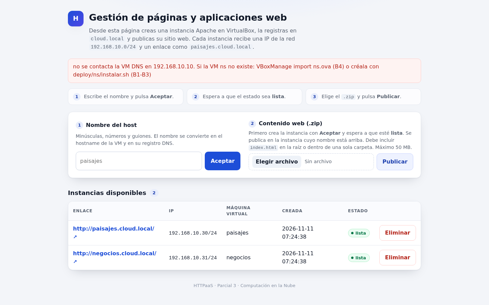

**B-12 — Banner con `ns` apagada.** **Pendiente:** bloqueado por A7. Cuando `ns` no
responde, el dashboard debe mostrar la receta (`VBoxManage import ns.ova` o
`deploy/ns/instalar.sh`) en vez de un error a medias. Importa porque convierte un
fallo de infraestructura en una acción concreta para el usuario.

---

## 6. Prueba de punta a punta (H4)

`scripts/prueba-completa.sh` (de A) hace, con la webapp corriendo:

1. Crear `paisajes` y `negocios`; esperar que ambas queden `lista`.
2. `dig @192.168.10.10 +short paisajes.cloud.local` → `192.168.10.30`.
3. Publicar `testdata/zips/paisajes.zip` y `negocios.zip`.
4. `curl -s http://paisajes.cloud.local/` y comprobar el contenido; lo mismo con
   `negocios`.
5. Crear `paisajes` otra vez → 422; subir `zipslip.zip` → 422.
6. Eliminar `paisajes`: la VM no está en `VBoxManage list vms`, `dig` no devuelve nada
   y `ApacheServer.vdi` sigue existiendo.
7. Eliminar `negocios`.

Imprime `OK`/`FALLA` por paso y termina con código distinto de 0 si algo falla.
**Pendiente (A + C):** ejecutarlo contra las VMs reales cuando A7 y C7 estén cerrados,
y adjuntar el resultado.

| Captura | Qué debe mostrar |
|---|---|
| A-11 | Dos instancias en el dashboard |
| A-12 | `dig` de las dos |
| A-13 | La página de `paisajes` abierta desde su enlace |
| A-14 | La página de `negocios` abierta desde su enlace |
| A-15 | Rechazo de `zipslip.zip` |
| A-16 | Resultado del script de prueba completa |

> **Pendiente (A):** completar el pie de cada una y adjuntar el resultado real.

---

## 7. Problemas encontrados

El detalle completo está en [`docs/problemas.md`](problemas.md). Los de la Parte B,
resumidos:

| Fecha | Problema | Causa | Solución |
|---|---|---|---|
| 2026-11-07 | `ns` no arranca: *no bootable option* | NVRAM vacío al copiar el VDI | `grub-install --removable` |
| 2026-11-07 | `grub-install` no existe | Solo estaba el GRUB que arranca | `apt install grub-efi-amd64` |
| 2026-11-07 | `apt` no resuelve | `enp0s8` en `DOWN` y DNS heredados | Interfaces correctas y `prepend` en `dhclient.conf` |
| 2026-11-08 | `named-checkconf`: `update-privacy` | Transcripción manual | Corregir a `update-policy` |
| 2026-11-08 | `dig ns.cloud.local` devuelve `.0` | `A` con la dirección de red | Corregir a `.10` |
| 2026-11-08 | `rndc reload` falla en zona dinámica | BIND no recarga desde archivo | `systemctl restart named` |
| 2026-11-09 | `listar` devuelve el FQDN | `sed` anclado al final de la línea | `awk` y quitar el sufijo |
| 2026-11-09 | `agregar ns` dice *invalid host* | El regex de longitud corría antes del reservado | Mover el chequeo |
| 2026-11-09 | `Resolve-DnsName -Server` no consulta otro DNS | NRPT se aplica antes | `nslookup` |
| 2026-11-09 | El adaptador reportaba éxito con `exit != 0` | El executor solo marca fallos de transporte | Revisar `res.ExitCode` |
| 2026-11-09 | El formulario no se alineaba y el móvil desbordaba | `max-width` y el `input[type=file]` nativo | Panel a ancho completo y selector propio |

> **Pendiente (A y C):** agregar sus problemas reales y mantener el detalle en
> `docs/problemas.md`.

---

## 8. Mejoras y trabajo futuro

De [`docs/problemas.md`](problemas.md):

- **M1 — Gestión de llaves SSH desde la interfaz.** Pegar una llave pública o generar
  un par y descargar la privada una vez. Hoy la llave se genera en H0 y cambiarla
  exige reconfigurar cada VM.
- **M2 — Aprovisionar `ns` desde la webapp.** Hoy es plataforma previa creada a mano;
  el producto solo la consume y falla con un mensaje claro.
- **M3 — Publicar en un solo paso desde el servidor.** `SolicitarCrearYPublicar`
  (nombre + zip) que cree, espere `lista` y publique, persistiendo el zip. La vista ya
  lo hace con JavaScript, pero depende de que la pestaña siga abierta; la versión
  robusta no debe depender del navegador.
- **M4 — Editar una instancia.** Fuera de alcance: hostname e IP no se cambian sin
  recrear la VM; requiere una operación y una ruta nuevas.

Otras mejoras identificadas en el camino:

- Mover los estilos a `static/estilos.css` cuando A agregue el servido de estáticos.
- Cambiar el `<meta refresh>` por polling a `/api/instancias` para no perder lo que el
  usuario escribe mientras hay una instancia ocupada.
- Que A mapee el error de publicar a `CampoArchivo` con un mensaje del tipo "primero
  crea la instancia con Aceptar".

---

## 9. Conocimientos aprendidos

**Daniel (Parte B).** Aprendí que una zona DNS con actualizaciones dinámicas tiene dos
estados —el archivo y la memoria del demonio— y que editar el archivo con `named`
encendido es la forma más rápida de corromperla. También que el sistema operativo del
host tiene su propia jerarquía de resolución (`nsswitch.conf`, NRPT) y que `dig` puede
decir "funciona" mientras el navegador no resuelve. En el dashboard, lo que más
cambió mi forma de trabajar fue probar con un viewport real y no confiar en una
captura: el ancho nativo de un `input[type=file]` rompía toda la página en móvil.

> **Pendiente (A y C):** un párrafo de cada uno.

---

## 10. Uso de IA

El equipo usó asistentes de IA como apoyo para escribir código, revisar PRs y redactar
documentación. Las reglas fueron: el diseño y las decisiones de arquitectura los tomó
el equipo (D1–D16 están en el plan y se cambiaron ahí primero); todo cambio se verificó
con pruebas, `gofmt`, `go vet`, `make check` y, cuando tocaba, contra las VMs reales; y
ninguna captura ni resultado se inventó: las capturas salen de la ejecución real y los
problemas se anotaron en `docs/problemas.md` cuando pasaron.

La IA fue útil sobre todo para acelerar la parte repetitiva (plantillas, scripts,
pruebas de tabla y revisión de código) y para detectar errores que se escapan en una
lectura rápida, como el ancho de un `input` o un `pipefail` que falla abierto. El
criterio para aceptar una sugerencia fue siempre el mismo: que se pudiera comprobar.

> **Pendiente:** que cada integrante agregue una línea sobre cómo la usó.

---

## 11. Referencias

- Oracle. *VirtualBox Manual*: `VBoxManage storageattach`, `export`/`import`,
  `guestproperty`, `showmediuminfo`. https://www.virtualbox.org/manual/
- Internet Systems Consortium. *BIND 9 Administrator Reference Manual*: zonas
  primarias, `update-policy`, `nsupdate`, `rndc freeze/thaw`.
  https://bind9.readthedocs.io/
- RFC 1035 — *Domain Names: Implementation and Specification*.
- RFC 2136 — *Dynamic Updates in the Domain Name System (DNS UPDATE)*.
- RFC 1123 — *Requirements for Internet Hosts*.
- Debian. *Debian Administrator's Handbook*: red, `systemd-resolved`, `nsswitch.conf`.
- The Go Authors. *Package `net`*, *Package `html/template`*, *Package `os/exec`*.
  https://pkg.go.dev/
- MDN Web Docs. *`<dialog>`*, *`fetch`*, *`FormData`*.
  https://developer.mozilla.org/
- OWASP. *Zip Slip Vulnerability*. https://owasp.org/www-community/attacks/

---

## Anexo. Cómo se genera este documento

`docs/DOCUMENTO.md` se escribe en Markdown y se exporta a PDF. Las capturas viven en
`docs/capturas/<código>.png` y cada una lleva un pie que dice qué se ve y por qué
importa. Para regenerar el PDF, cualquier editor de Markdown con exportación sirve
(Pandoc, VS Code, Typora); el repositorio no depende de una herramienta concreta.

**Checklist antes de entregar.**

- [ ] Secciones de A y C completas.
- [ ] Capturas P-01, A-01…A-16, B-01…B-12 y C-01…C-12 presentes y en orden.
- [ ] Problemas de A y C agregados a la sección 7.
- [ ] Párrafos de aprendizajes de A y C.
- [ ] Prueba completa H4 ejecutada y adjunta.
- [ ] PDF exportado y revisado por los tres.
